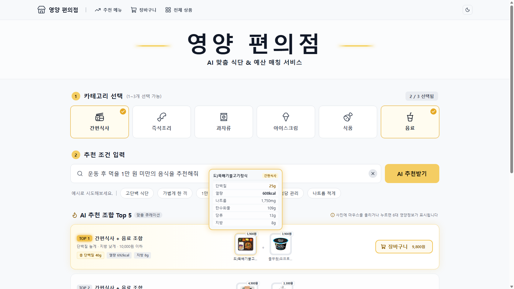
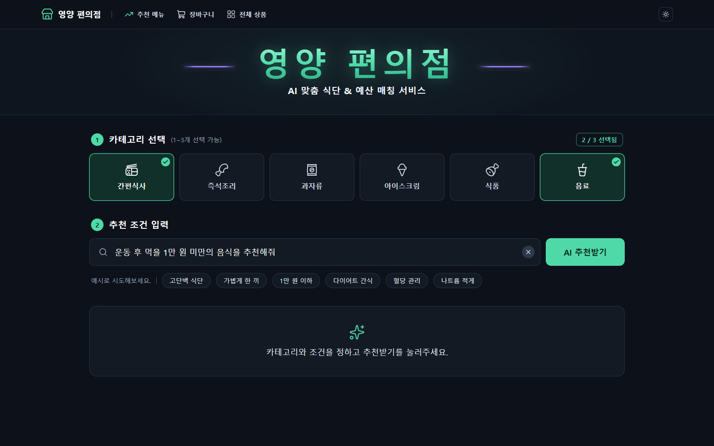
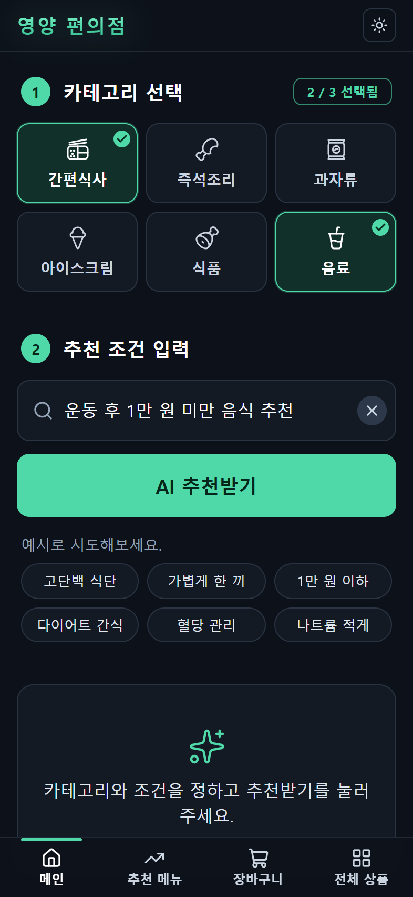

# 영양 편의점 (Pick CU)

상황과 예산을 평소 말투로 적으면, CU 상품 2,154개 중에서 예산 안의 상품 조합 Top 5를 영양 합계와 함께 추천하는 서비스입니다. 팀 아이넷의 LLM 수업 프로젝트입니다.

**프로젝트 페이지: https://meloncookiee.github.io/pick-cu/**

## 문제

편의점에서 운동 후 먹을 것, 5천 원짜리 한 끼, 덜 짠 야식처럼 목적과 예산에 맞게 고르려면 상품마다 영양성분표를 읽고 가격과 영양을 직접 더해야 합니다.

- "운동 후 먹을 1만 원 미만의 음식을 추천해줘"
- "5000원으로 든든한 한 끼 추천해줘"
- "내일 얼굴 안 붓게 짠 거 말고 야식 추천해줘"

기존 서비스로는 이 질문에 답하기 어렵습니다.

| 서비스 | 한계 | 영양 편의점 |
| --- | --- | --- |
| 편의점 자체 앱 | 상품·행사·재고 조회는 되지만 목적별 조합 추천과 영양 합산이 없음 | 목적·예산에 맞는 조합과 영양 합계 |
| 범용 LLM 챗봇 | 자연어로 추천하지만 실제 제품·가격·영양을 추정함(환각) | LLM은 해석만, 수치는 DB와 코드가 계산 |
| 행사 비교 앱 | 행사 중심이라 영양 기반 추천이 없음 | 영양 목표 기반 추천 |
| 식단 기록 앱 | 먹은 뒤 기록하는 용도라 구매 전 선택은 돕지 않음 | 고르기 전에 바로 추천 |

## 해결 방법과 데모

카테고리를 1~3개 고르고 문장을 적으면, 카테고리마다 1개씩 묶은 조합 5개가 합계 가격·영양 합계와 함께 나옵니다.

```
입력: "운동 끝나고 5천원으로 먹을 거 추천해줘" + 카테고리 간편식사, 음료
해석: 단백질 높게 · 지방 낮게 · 예산 5,000원
결과: 간편식사 158개 × 음료 404개 → 예산 안 조합 63,832개 → Top 5 (1위 82.3점 · 4,900원)
```



| 다크 모드 | 휴대폰 화면 |
| --- | --- |
|  |  |

### 작동 원리

LLM은 문장을 해석하는 1단계에서만 씁니다. 나머지는 DB와 Python 코드가 계산하므로 없는 상품이나 틀린 수치를 지어내지 않습니다.

| 단계 | 하는 일 | 담당 |
| --- | --- | --- |
| 1. 자연어 전처리 | 영양 조건 2개와 방향(높게·낮게)을 JSON으로 추출, 예산은 규칙 코드로 추출 | A.X-4.0-Light (QLoRA 파인튜닝) |
| 2. 가격 필터 | 예산이 있으면 단품 가격 상한을 검색 조건에 추가 | 규칙 코드 |
| 3. DB 조회 | 고른 카테고리마다 후보 검색 (소스·양념 등 24개는 제외) | SQLite |
| 4. Top 5 필터 | 카테고리마다 1개씩 조합, 합계 ≤ 예산, 영양 0.7 + 가격 0.3 점수, 중복 제거 | Python |
| 5. 화면 표시 | 추천 카드, 합계 가격, 영양 정보, 별점, 장바구니 | React · Vite |

- 화면 → FastAPI 서버 → 문장 해석 → 추천 엔진 순서로 요청이 흐릅니다.
- 영양소를 찾지 못하면 다시 묻고, 예산 안에 결과가 없으면 예산을 10% 넓혀 다시 찾습니다.
- 사용자가 남긴 별점은 추천 순위에 반영됩니다.

## 결과

문장 해석은 영양 조건 2개와 방향이 모두 맞아야 정답으로 셌습니다(완전 정답률). 학습에 쓰지 않은 문장으로만 쟀습니다.

| 항목 | 결과 | 비교 대상 |
| --- | --- | --- |
| 최종 시험 (240문장) | **85.8%** | 파인튜닝 전 원본 모델 62.5%, 목표 80% |
| 검증 문장 (216문장) | **86.1%** | 프롬프트만 개선했을 때 44% 근처가 한계 |
| 상품 DB | **2,154개** | 영양성분표 이미지 3,873건을 Vision LLM으로 읽고 검증 |
| 응답 속도 (RTX 4060) | **문장당 0.81초** | 양자화 전(4bit + 어댑터) 3.3초 |

개선 과정 (검증 문장 216개 기준)

| 단계 | 완전 정답률 |
| --- | --- |
| 영양 성분 2개 추출로 과제 변경 | 14.4% |
| 짝 규칙표로 라벨 통일 | 44.0% |
| 데이터 v3 정리 | 43.5% |
| QLoRA 파인튜닝 (학습 문장 2,550개, 4bit NF4, LoRA r16) | **86.1%** |

- **모델 비교:** 같은 데이터로 EXAONE-3.5-7.8B도 파인튜닝했습니다. 최종 시험은 EXAONE 88.3%, A.X 85.8%였지만 통계적으로 구분되지 않아(McNemar p = 0.29) A.X를 유지했습니다.
- **양자화:** 원본 약 14.5GB + 어댑터를 파일 하나(5.2GB)로 합쳐 8GB GPU에서 실행되게 했습니다. 정확도는 유지했습니다.

## 한계와 다음 단계

| 아직 부족한 점 | 다음 단계 |
| --- | --- |
| 최종 시험 문장이 12개 상황이라 정확도가 ±10%p 정도 흔들릴 수 있음 | 새 평가 문장을 만들어 다시 검증 |
| 영양 조건이 없는 문장("아무거나") 학습이 부족함 | '조건 없음' 예시를 넣어 2차 파인튜닝 |
| 이미 쓴 금액을 빼는 새 예산 규칙은 만들었지만 서비스에 아직 반영 안 됨 | 새 예산 규칙 반영, 예산 부족·카테고리 불일치 안내 추가 |
| 카테고리마다 1개씩만 담고, 1+1·2+1 행사는 표시만 함 | 편의점 앱·챗봇 연동, 다른 편의점으로 확장 |

## 팀

| 팀원 | 담당 |
| --- | --- |
| hayoung | LLM 선정·파인튜닝, 자연어 전처리 |
| jongho | API 서버, 예산 규칙, 모델 비교 |
| hyeokjun | 웹 화면, A.X 기준선 평가 |
| knlee | 데이터 수집·DB, 추천 엔진, 통합 |

## 링크

- 프로젝트 페이지: https://meloncookiee.github.io/pick-cu/
- GitHub 저장소: https://github.com/nnujabes/Pick_CU (팀 비공개 · 권한이 있는 사람만 열림)
- 파인튜닝 어댑터: https://huggingface.co/nnujabes/pickcu-ax-4.0-light-lora
- 발표자료: [presentation/최종PPT.pptx](presentation/최종PPT.pptx) (PowerPoint, 42장)
- 시연 영상: 준비 중

이 저장소는 프로젝트 소개 페이지(`index.html`)만 담고 있습니다. 코드와 실행 방법은 팀 저장소에 있습니다.
